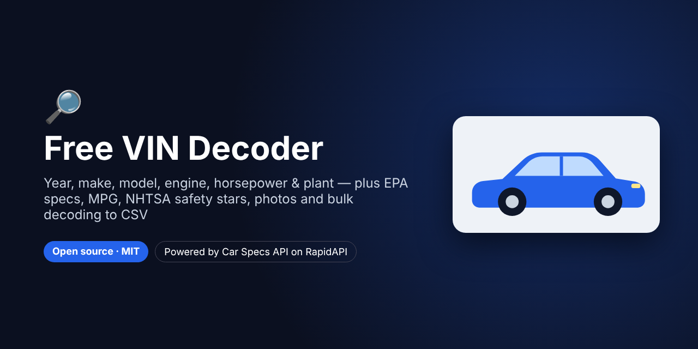
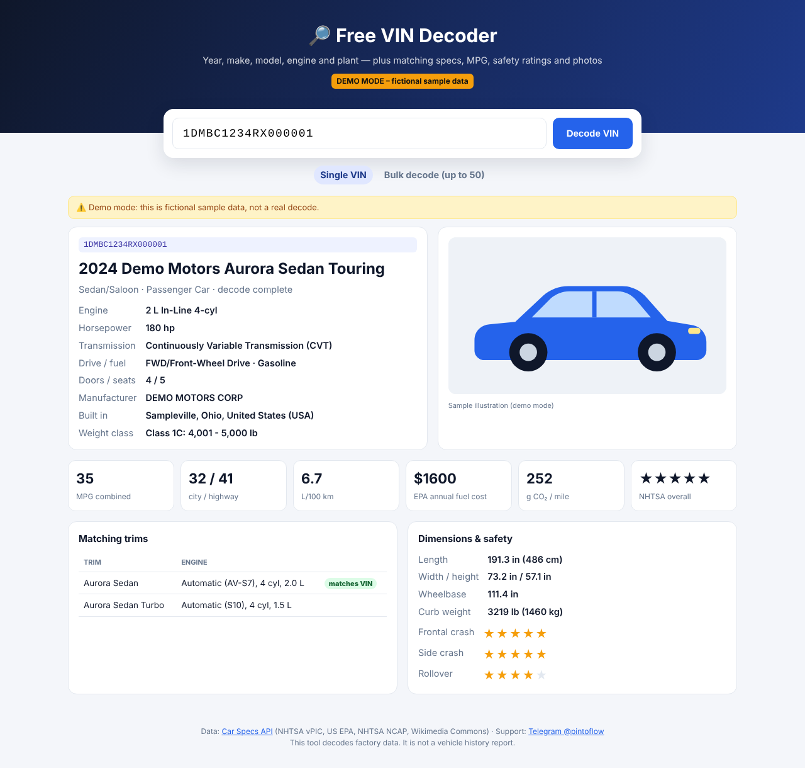
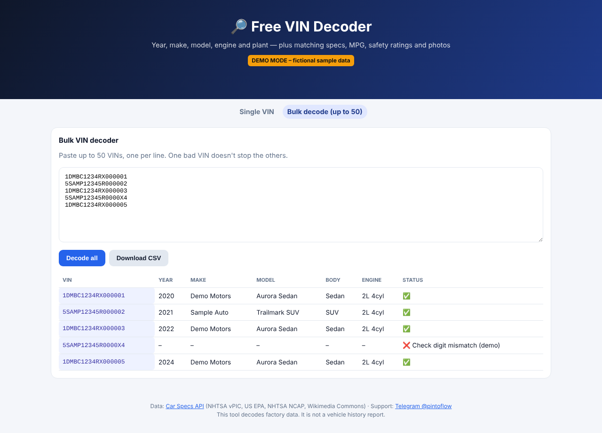
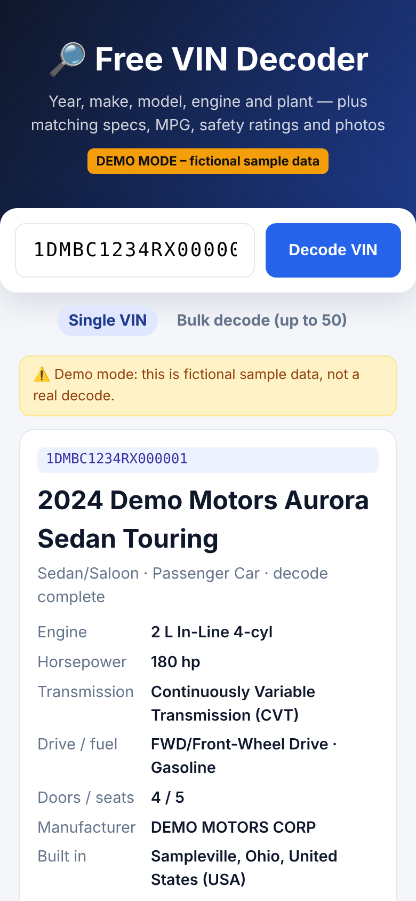

# Free VIN Decoder – Full Specs, MPG, Safety Ratings & Photos



> **For faster support reply, contact us on Telegram: [@pintoflow](https://t.me/pintoflow)**

A free, open-source, self-hosted **VIN decoder**. Enter a 17-character VIN and get:

- **Year, make, model, trim**, body, doors and seats
- **Engine** (size, cylinders, configuration, **horsepower**), transmission, drive type and fuel
- **Where it was built** (plant city, state and country), manufacturer and weight class
- the **matching EPA trims**, with the one that fits the VIN's engine flagged
- **MPG / MPGe**, EV range, L/100 km, CO₂ and annual fuel cost
- **Dimensions** and **NHTSA 5-star safety ratings**
- a **photo** with its licence attribution

It also has a **bulk VIN decoder** (up to 50 VINs at once) with **CSV export**, and VIN **check-digit validation** that suggests a fix for mistyped VINs.

Node.js with **zero dependencies**. Powered by the **[Car Specs API](https://rapidapi.com/belchiorarkad-FqvHs2EDOtP/api/car-specs-api)** on RapidAPI.







<sub>Screenshots in demo mode with a fictional VIN and fictional vehicles.</sub>

---

## Why this exists

"VIN decoder", "free VIN lookup" and "VIN check" are among the most searched car queries. Dealers, used-car buyers, insurers, parts shops and fleet managers decode VINs every day. Most free decoders show the year, make and model and then upsell a paid report. This one shows full factory specs for free, on your own site.

## Quick start

```bash
git clone https://github.com/BelNaruto/free-vin-decoder.git
cd free-vin-decoder

node server.js                                 # demo mode (fictional sample data)
RAPIDAPI_KEY=your_rapidapi_key node server.js  # live data
```

Open **http://localhost:3000**. Requires Node.js 18 or newer, and there's nothing to install.

Get a key: **https://rapidapi.com/belchiorarkad-FqvHs2EDOtP/api/car-specs-api**

## API endpoints used

| Endpoint | Used for |
|---|---|
| `GET /vin/validate?vin=` | Length, illegal characters and check digit, with a corrected `suggestion` |
| `GET /vin/specs?vin=` | **VIN → full bundle**: decoded VIN, matching trims (`likelyTrimIds`, `engineMatch`), spec sheets, dimensions, safety ratings and photos |
| `GET /vin/decode?vin=&compact=true` | Fallback for VINs that decode but don't match an EPA trim (e.g. non-US vehicles) |
| `POST /vin/batch` | Up to 50 VINs in one call |

## Ideas

- Add it to a **used-car dealer** or **classifieds** site ("decode this VIN" button)
- **Auto-fill listing forms** from a VIN
- **Fleet onboarding**: bulk-decode a spreadsheet of VINs to CSV
- **Insurance or parts** lookups by VIN

## Deploy

One Node.js server and one HTML file. Deploy to **Google Cloud Run, Render, Railway, Fly.io** or any VPS with the start command `node server.js` and the env var `RAPIDAPI_KEY`.

## Related projects

- 🚗 [Car Comparison Tool](https://github.com/BelNaruto/car-comparison-tool): compare up to 4 cars side by side
- ⛽ [Car Fuel Cost Calculator](https://github.com/BelNaruto/car-fuel-cost-calculator): gas vs hybrid vs electric running costs
- 📘 [Car Specs API docs and examples](https://github.com/BelNaruto/car-specs-api)

## Support

> **For faster support reply, contact us on Telegram: [@pintoflow](https://t.me/pintoflow)**

API: https://rapidapi.com/belchiorarkad-FqvHs2EDOtP/api/car-specs-api

---

MIT License. This tool decodes factory data from NHTSA vPIC, US EPA and NHTSA NCAP. It is not a vehicle history report (accidents, title or mileage).

**Keywords:** vin decoder, free vin decoder, vin lookup, vin check, decode vin, vin number lookup, car specs by vin, bulk vin decoder, vin to csv, nhtsa vin decoder
